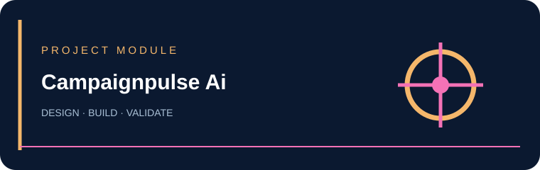

# CampaignPulse AI — Adobe Campaign Edition



**An independent campaign intelligence mini-tool by Sangram Ghatge.**

CampaignPulse turns aggregate email campaign metrics into deterministic KPIs, transparent health diagnostics, evidence-labelled findings and prioritized Adobe Campaign operational checks.

> Paste the numbers. Understand what happened. Know what to check next.

## Live demo

[Launch CampaignPulse AI](https://campaignpulse-ai.streamlit.app/)

## Launch locally

Python 3.10+

```bash
pip install -r requirements.txt
streamlit run app.py
```

## What it does

- Manual campaign metric entry and multi-row CSV upload
- Fictional demonstration scenarios
- Deterministic delivery, bounce, open, click, CTOR and unsubscribe calculations
- Input validation and delivery reconciliation
- Configurable starter thresholds in `config/campaignpulse_thresholds.json`
- Evidence-labelled findings and practical Adobe Campaign checks
- Practitioner checklist and management summary
- Markdown and JSON report exports
- Optional Gemini narrative; deterministic metrics and findings remain authoritative

## Streamlit Community Cloud deployment

This repository is structured for its own standalone Streamlit app.

1. Open [Streamlit Community Cloud](https://share.streamlit.io/).
2. Choose **Create app** and connect the GitHub account if prompted.
3. Select repository `sghatge/campaignpulse-ai`, branch `main`, and main file path `app.py`.
4. Deploy. The app uses the free Community Cloud tier.
5. Optional: add `GEMINI_API_KEY` in **App settings → Secrets** to enable the bounded AI explanation. The core analysis works without it.

No Vercel deployment or paid hosting is required.

## Tests

```bash
python -m unittest discover -s tests -v
```

GitHub Actions runs compilation and the unit-test suite on pushes and pull requests to `main`.

## V1 validation status

- Live Streamlit application opened successfully.
- All three built-in demonstration scenarios were manually tested successfully: healthy delivery, poor deliverability and declining engagement.
- CSV template upload, campaign-row analysis and CSV validation were manually confirmed.
- Markdown and JSON report downloads were manually confirmed.
- Automated GitHub Actions compilation and unit tests passed on the latest recorded run: [run #9](https://github.com/sghatge/campaignpulse-ai/actions/runs/45459944206).

Manual checks above were confirmed by the project owner. They are acceptance checks, not an independent third-party audit.

## Data and safety boundaries

- Use synthetic or sanitized aggregate campaign counts only.
- Do not upload recipient-level PII, email addresses, broadlogs, production delivery logs, confidential client data or credentials.
- CampaignPulse does not connect to, inspect or modify an Adobe Campaign instance.
- Thresholds are configurable starter rules, not universal industry benchmarks or an Adobe-certified score.
- Human practitioners must verify operational checks before taking action.

## ModletHub creator package

- [Creator submission pack](modlethub/CREATOR_SUBMISSION.md)
- [Detailed AI playbook](modlethub/CAMPAIGNPULSE_AI_PLAYBOOK.md)
- [Structured workflow manifest](modlethub/campaignpulse_manifest.json)

The creator package is prepared for review; it has not been submitted to ModletHub. Confirm creator licence, attribution, AI reuse, exclusivity, deletion and commercial terms before publication.

## Project structure

```
app.py
assets/
  campaignpulse-banner.svg
campaignpulse/
  engine.py
  reasoning.py
  samples.py
config/
modlethub/
schemas/
tests/
.github/workflows/
```

**Creator:** Sangram Ghatge · **Version:** 1.0 · **Status:** Standalone V1
